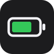
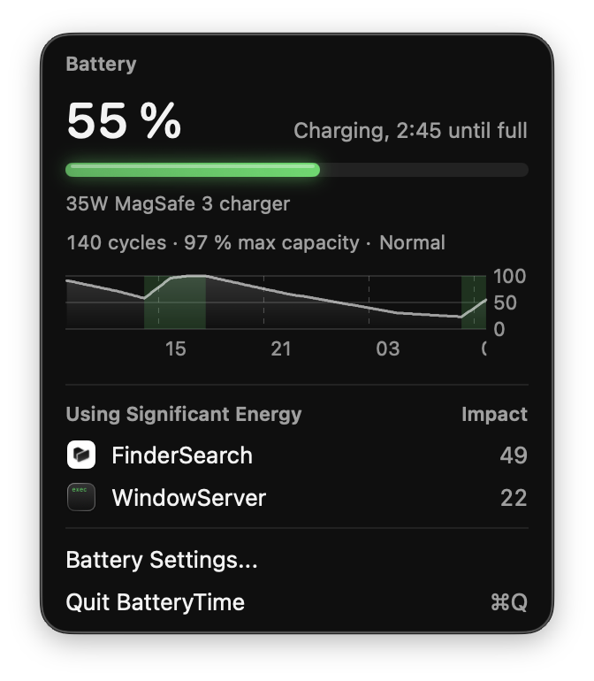
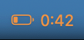

<p align="center">
  
</p>

<h1 align="center">BatteryTime</h1>

<p align="center">
  <b>The battery time remaining, back in the macOS menu bar.</b><br>
  A minimal menu bar app with a Liquid Glass panel for charge, power
  draw, history, health and energy hogs.
</p>

<p align="center">
  
</p>

<p align="center">
  
  &nbsp;
  
  &nbsp;
  
  &nbsp;
  
</p>

macOS no longer shows how long the battery will last. BatteryTime puts
it next to the battery icon, colors it when the charge runs low, and
opens a panel with everything worth knowing about the battery: what
draws power, how the charge evolved over the day, and how worn the
battery is.

## Highlights

- **Time at a glance.** Time remaining on battery, time to full while
  charging, right in the menu bar.
- **Follows the charge limit.** Learns the macOS Charge Limit setting
  and counts charging time until it instead of until 100 %.
- **Warns before it's too late.** The title turns orange at 20 %, red at
  10 %, and a notification follows.
- **Finds what drains it.** The apps with a significant energy impact,
  with their icon; Option-click to quit one.
- **The last 24 hours.** A charge curve with plugged-in periods shaded.
- **Battery health.** Cycle count, maximum capacity and condition, as in
  System Settings.
- **Quiet.** Follows power source events instead of polling; energy use
  is only measured while the panel is open.

## Menu bar

| State | Display |
|-------|---------|
| On battery | battery icon then `3:45` |
| Charging | battery icon and bolt, then `1:20` |
| Fully charged | battery icon |
| At the charge limit | battery icon then `Limit 80 %` |
| Plugged in, not charging | battery icon |
| Calculating | battery icon, bolt while charging, then `...` |
| No battery | `No battery` |

The battery icon always shows the charge level. SF Symbols has no
battery with a bolt for each level, so a bolt follows it while
charging.

macOS does not let apps read the Charge Limit setting, so BatteryTime
learns it: when it sees charging stop below 100 % and the charge stay
there for 10 minutes, it keeps that percentage. The limit is the median
of the last 7 such stops, rounded to the nearest setting (80, 85, 90,
95 or 100 %). Charging more than 3 points above it means the setting
changed, and BatteryTime counts until 100 % again until it sees the
next stop. The time until the limit comes from the capacity left and
the charging current, as charging slows down past 80 %.

On battery, the title turns orange at 20 % or less and red at 10 % or
less, the same thresholds as the charge bar of the panel.

## Panel

- Battery percentage, charge bar and time remaining
- Power drawn on battery (`Using 10.4 W`), or the charger's wattage and
  port when plugged in (`67W USB-C charger`)
- Charge level over the last 24 hours, plugged-in periods shaded green
- Battery health: cycle count, maximum capacity and condition
- Processes using significant energy, with their app icon
- Battery Settings shortcut
- Quit (⌘Q)

### Energy use

Energy use is measured with `top` when the panel opens, never in the
background: it takes a few seconds and the panel shows "Measuring energy
use..." meanwhile. Up to five apps or processes with an energy impact
of 20 or more are listed, the same figure as Activity Monitor's Energy
Impact column; clicking one opens Activity Monitor. Holding Option
turns the impact of each app into "Quit": an Option-click asks the app
to quit, as ⌘Q would. Processes that are not apps keep opening Activity
Monitor.

### Charge history

The charge history is sampled while the app runs, every five minutes or
on any change, and kept across restarts. The curve is cut wherever the
app was not running or the Mac was asleep for a while.

### Battery health

Maximum capacity is the full charge capacity against the design
capacity, as in System Settings. The condition turns to "Service" when
the battery reports a permanent failure or falls under 80 %, the
threshold Apple uses for its service recommendation.

## Notifications

On battery, a notification when the charge drops to 20 % then to 10 %.
While plugged in, one when it reaches 80 % then 100 %. Each threshold
notifies once, then again only after the charge has gone back past it
the other way. macOS asks for permission on first launch.

## Requirements

- A Mac with a battery on macOS 26 (the panel uses Liquid Glass)
- The Swift toolchain (Xcode or Command Line Tools) to build it

## Install

```sh
./install.sh         # builds, copies to /Applications, starts at login
```

To update, pull and install again: the running app is replaced and
restarted.

```sh
git pull
./install.sh
```

To remove it:

```sh
./uninstall.sh
```

## Development

```sh
./build.sh && open BatteryTime.app   # build and run without installing
swift test                           # run the tests
bin/lint                             # swift format and swiftlint, strict
bin/lint --fix                       # apply automatic corrections first
```

`bin/lint` needs `swiftlint` (`brew install swiftlint`); `swift format`
ships with the Swift toolchain.
