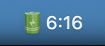
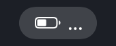

# BatteryTime

Minimal macOS menu bar app displaying battery time remaining.

  

## Display

| State | Display |
|-------|---------|
| On battery | `🔋3:45` |
| Charging | `⚡1:20` |
| Fully charged | `⚡` |
| Calculating | `...` |

## Menu

- Battery percentage
- Battery Settings shortcut

## Install

```bash
./install.sh
```

Builds, copies to `/Applications`, and starts at login.

## Uninstall

```bash
./uninstall.sh
```

## Build only

```bash
./build.sh
open BatteryTime.app
```

## Lint

```bash
bin/lint
```

Runs `swift format` (shipped with the Swift toolchain) and `swiftlint`
(`brew install swiftlint`) in strict mode. `bin/lint --fix` applies
automatic corrections first.
